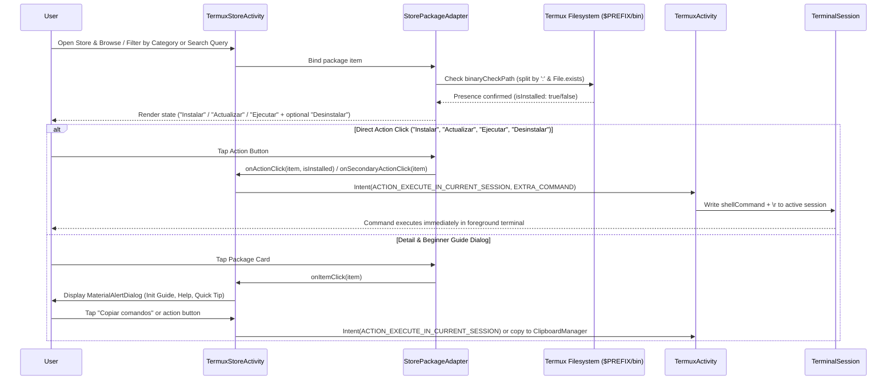

# Termux Store & Package Management Workflow

The **Termux Store** (`com.termux.app.store`) is an interactive package discovery, installation, and tools management subsystem within the `:app` module. Styled after modern application stores (Google Play Store dark theme), it provides a curated catalog enabling users to search, inspect installation state, read beginner and initialization guides, copy setup commands, and install, update, launch, or uninstall CLI tools, programming runtimes, system utilities, and AI developer CLI tools directly in their active terminal session.

---

## Architecture & Interaction Flow

`TermuxStoreActivity` interacts directly with the local Termux filesystem to determine package installation state, and communicates with `TermuxActivity` via `ACTION_EXECUTE_IN_CURRENT_SESSION` to execute commands inside the active terminal session without spawning separate background scripts or secondary sessions.


*Sequence of package inspection, guide interaction, and direct command execution from Termux Store.*

---

## Core Components & Data Model

### 1. `StorePackageItem` (`com.termux.app.store.StorePackageItem`)
Represents an individual entry in the package store catalog:
- **`id`** (`String`): Unique package identifier (e.g., `"git"`, `"openwiki"`, `"codegraph"`, `"engram"`, `"zsh"`, `"neovim"`).
- **`title`** (`String`): Human-readable package title displayed in cards and dialogs.
- **`categoryId`** (`String`): Category ID for filtering (`"sistema"`, `"herramientas"`, `"desarrollo"`, `"google"`, `"ia"`).
- **`category`** (`String`): Human-readable category display badge (e.g., `"IA y CLI • Wiki & Arquitectura"`).
- **`description`** (`String`): Detailed overview of tool capabilities.
- **`iconResId`** (`int`): Resource ID of the package icon drawable (`R.drawable.ic_pkg_*`).
- **`installCommand`** (`String`): CLI command string executed to install (e.g., `"pkg install lazygit -y"` or `"npm install -g @colbymchenry/codegraph"`).
- **`uninstallCommand`** (`String`, nullable): Optional removal command (e.g., `"pkg uninstall lazygit -y"`).
- **`updateCommand`** (`String`, nullable): Optional update command executed when the package is already installed.
- **`binaryCheckPath`** (`String`, nullable): Colon-separated (`:`) list of candidate binary paths in `$PREFIX/bin/` or `$HOME/` used to verify installation status.
- **`rating`** (`String`): Star rating display (e.g., `"4.9 ★"`).
- **`size`** (`String`): Approximate download/install size (e.g., `"15 MB"`).
- **`initGuide`** (`String`, nullable): Step-by-step instructions for initializing the tool.
- **`helpGuide`** (`String`, nullable): Commands for accessing help and documentation.
- **`quickTip`** (`String`, nullable): Beginner tips and best practices.
- **`ActionType`** (`enum`): `INSTALL`, `UPDATE`, `UNINSTALL`, `EXECUTE`.

### 2. `StorePackageAdapter` (`com.termux.app.store.StorePackageAdapter`)
A `RecyclerView.Adapter` rendering package cards and handling user interaction:
- **Filtering**: Filters items in real time based on search query strings and active category chips.
- **Dynamic Binary Status**: Iterates through colon-separated paths in `item.getBinaryCheckPath()`. If any path exists (`new File(path).exists()`), the package is marked as installed.
- **Button State Resolution**:
  - If `binaryCheckPath == null`: Displays single **"Ejecutar"** button (for system utilities like storage permission setup or backup/restore).
  - If installed: Displays primary **"Actualizar"** button and secondary **"Desinstalar"** button (if `uninstallCommand` is present).
  - If not installed: Displays primary **"Instalar"** button.
- **Package Details Dialog**: Clicking the card triggers `onItemClick()`, presenting a Material Design dialog containing `description`, `initGuide`, `helpGuide`, `quickTip`, and a **"Copiar comandos"** button.

### 3. `TermuxStoreActivity` (`com.termux.app.store.TermuxStoreActivity`)
Main activity managing the catalog lifecycle and terminal bridging:
- **Search & Chips**: Real-time search bar with clear button (`store_search_clear`) and horizontal category chips (`"Para ti"`, `"Sistema"`, `"Herramientas"`, `"Desarrollo"`, `"Google"`, `"IA & CLI"`).
- **`executeShellCommandInTerminal()`**: Bridges package actions directly to the active terminal session.
- **Script Cleanup**: Defensively removes any legacy `setup_zsh.sh` files from `$HOME` or cache directory to prevent conflicting multi-step script executions.
- **Shell Customization & Aliases**: On Zsh and catalog operations, automatically configures productivity aliases in `~/.zshrc`:
  - `alias x="exit"` and `alias X="exit"`: Instant session termination.
  - `alias c="clear"` and `alias C="clear"`: Terminal screen clearing.

---

## Direct Active Session Execution Pipeline

Unlike legacy approaches that created temporary `.sh` shell scripts or opened separate sessions:
1. `TermuxStoreActivity` packages the target shell command string.
2. Constructs an explicit `Intent` targeting `TermuxActivity`:
   ```java
   Intent termuxIntent = new Intent(this, TermuxActivity.class);
   termuxIntent.setAction(TermuxActivity.ACTION_EXECUTE_IN_CURRENT_SESSION);
   termuxIntent.putExtra(TermuxActivity.EXTRA_COMMAND, commandToSend);
   termuxIntent.setFlags(Intent.FLAG_ACTIVITY_REORDER_TO_FRONT);
   startActivity(termuxIntent);
   ```
3. `FLAG_ACTIVITY_REORDER_TO_FRONT` brings the existing `TermuxActivity` directly to the foreground without recreating it.
4. `TermuxActivity.onNewIntent(Intent)` receives `ACTION_EXECUTE_IN_CURRENT_SESSION`, extracts `EXTRA_COMMAND`, and dispatches it via `executeCommandInCurrentSession()`.
5. Instead of fragmenting multiline strings with raw `write()`, `executeCommandInCurrentSession()` uses `TerminalEmulator.paste()` (utilizing DECSET 2004 Bracketed Paste Mode when active) followed by an atomic carriage return (`\r`), executing the entire composite command as a single paste block.
6. The command runs interactively in the current terminal prompt, allowing users to watch installation progress and respond to interactive prompts (such as `[Y/n]` confirmations).

---

## Curated Catalog Categories & Packages

The catalog is organized into five functional categories:

| Category ID | Display Label | Packages Included | Primary Commands |
|---|---|---|---|
| **`ia`** | **IA & CLI** | OpenWiki CLI, CodeGraph, Engram | `npm install -g openwiki`, `npm install -g @colbymchenry/codegraph`, `engram` setup |
| **`sistema`** | **Sistema** | Termux Storage (`termux-setup-storage`), Backup/Restore, Mirrors Config (`termux-change-repo`), Termux-API | `termux-setup-storage`, `pkg install termux-api -y` |
| **`herramientas`** | **Herramientas** | Zsh + Oh My Zsh (con aliases `x`/`c`), Lazygit, Yazi, Neovim, Tmux, Htop | Direct `pkg install` + theme setups |
| **`desarrollo`** | **Desarrollo** | Git, GitHub CLI (`gh`), Node.js, Python, Golang, Rust | Runtime installs and CLI compilers |
| **`google`** | **Google** | Gemini CLI, Cloud SDK, Angular CLI, Antigravity | CLI developer tools for cloud and web |

---

## Core API & Method Signatures

| Class | Method | Visibility & Signature | Responsibility |
|---|---|---|---|
| `TermuxStoreActivity` | `start` | `public static void start(@NonNull Context context)` | Static launcher helper starting the Store Activity. |
| `TermuxStoreActivity` | `initPackageList` | `private void initPackageList()` | Builds the curated package catalog with descriptions, commands, and aliases. |
| `TermuxStoreActivity` | `selectCategoryChip` | `private void selectCategoryChip(@Nullable String category)` | Selects category filter, updates chip UI, and re-filters adapter. |
| `TermuxStoreActivity` | `filterPackages` | `private void filterPackages(String query, String categoryFilter)` | Computes search query and category intersection, updating adapter items. |
| `TermuxStoreActivity` | `executeShellCommandInTerminal` | `private void executeShellCommandInTerminal(String command)` | Sends `ACTION_EXECUTE_IN_CURRENT_SESSION` to foreground terminal. |
| `StorePackageAdapter` | `updateList` | `public void updateList(List<StorePackageItem> newList)` | Replaces active package list and refreshes RecyclerView layout. |
| `StorePackageAdapter` | `checkIfInstalled` | `private boolean checkIfInstalled(StorePackageItem item)` | Evaluates colon-separated `binaryCheckPath` for file existence. |
| `StorePackageAdapter` | `showPackageDetailsDialog` | `private void showPackageDetailsDialog(StorePackageItem item)` | Displays Material Dialog with setup guide, help, and copy actions. |

---

## Invariants & Error Handling

- **Zero Temporary Scripts**: No `.sh` scripts are written to `$HOME` or cache directories during store package dispatch. All executions stream directly to the foreground terminal session.
- **Multi-Path Binary Verification**: Packages providing multiple binaries or alternative paths (e.g., `binaryCheckPath` containing multiple colon-delimited paths) are considered installed if any candidate exists.
- **Safe Session Fallback**: If `TermuxActivity` has no active session when receiving `ACTION_EXECUTE_IN_CURRENT_SESSION`, it ensures the primary session is initialized before writing the command.
- **Clipboard Utility Integration**: Users can preview initialization and help commands and copy them cleanly to the Android system clipboard without triggering terminal execution.
