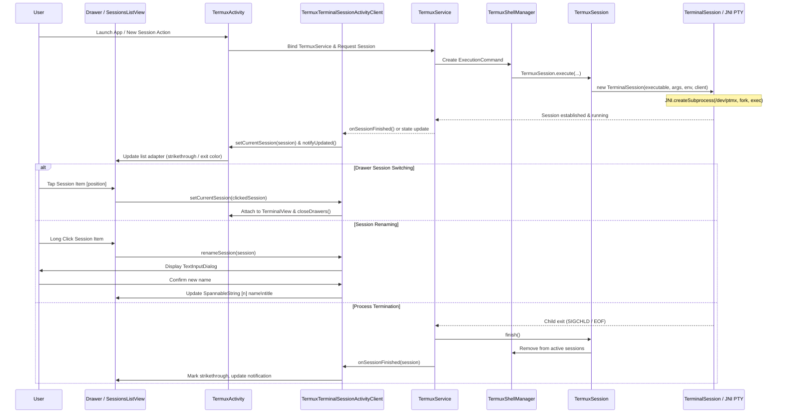

# Terminal Session Lifecycle & Management

Terminal sessions in Termux represent interactive or automated shell processes coupled to a pseudo-terminal (`pty`) interface. The lifecycle encompasses bootstrap verification, environment preparation, process spawning via native Unix system calls, foreground service management via `TermuxService`, user interface integration via `TermuxDrawerLayout` and `TermuxSessionsListViewController`, and cleanup/destruction.

---

## Architectural Overview & Interaction Flow

The lifecycle connects the foreground UI layer (`TermuxActivity`, `TermuxSessionsListViewController`), the headless background runtime (`TermuxService`, `TermuxShellManager`), and the underlying emulation core (`TermuxSession`, `TerminalSession`, `JNI`).


*End-to-end lifecycle and drawer UI interaction for terminal sessions.*

---

## Detailed Lifecycle Phases

### 1. Bootstrap & Environment Preparation
Before spawning any shell, `TermuxInstaller.setupBootstrapIfNeeded()` verifies that bootstrap utilities exist under `$PREFIX`. When a session request is initiated:
- Standard interactive sessions evaluate login shell candidates (`/data/data/com.termux/files/usr/bin/login` or shells defined in `chsh`/`SHELL`).
- **Failsafe Sessions**: If the user requests a failsafe session (via the drawer long-press on "NEW SESSION" or notification shortcut), `TermuxActivity.addNewSession(true, null)` bypasses the `$PREFIX` environment, running `/system/bin/sh` without loading user dotfiles, enabling recovery from corrupted `.zshrc` or `.bashrc` scripts.
- The execution command (`ExecutionCommand`) resolves environment variables (`PATH`, `LD_LIBRARY_PATH`, `HOME`, `PREFIX`, `TMPDIR`) via `TermuxShellEnvironment`.

### 2. Native Process Spawning (`TerminalSession` & `JNI`)
`TerminalSession` creates two ring buffers (`ByteQueue` for `mProcessToTerminalIOQueue` and `mTerminalToProcessIOQueue`) and invokes the native JNI method:
```c
JNI.createSubprocess(executable, cwd, args, env, processIdArray, rows, columns);
```
Under the hood in `termux.c`:
1. Opens `/dev/ptmx` to allocate a pseudo-terminal master/slave pair.
2. Configures termios input/output modes (enabling `IUTF8`).
3. Spawns the child process via `fork()`, attaches `stdin`/`stdout`/`stderr` to the slave PTY, and calls `execve()`.
4. Returns the master PTY file descriptor to Java.

### 3. Foreground Service Coordination (`TermuxService`)
Active sessions are registered inside `TermuxShellManager.mTermuxSessions`:
- `TermuxService` manages a foreground service with persistent notifications to shield shell processes from Android low-memory killer (OOM) evictions.
- Wakelocks and Wi-Fi locks (`acquireWakeLock`, `acquireWifiLock`) prevent CPU sleep when running background tasks or server daemons.

### 4. User Interface & Drawer Management (`TermuxSessionsListViewController`)
The session drawer on the left of `TermuxActivity` (`TermuxDrawerLayout`) displays active sessions using `TermuxSessionsListViewController`:
- **Title Formatting**: Formats session titles with `SpannableString`:
  - Prefix `[position + 1]` in bold.
  - Custom session name `mSessionName` (if renamed) in bold.
  - Window title `sessionAtRow.getTitle()` in italic on a new line.
- **Process Status Indication**:
  - If `session.isRunning()` is true: normal rendering.
  - If finished: applies `Paint.STRIKE_THRU_TEXT_FLAG`.
  - Exit code coloring: White/Black for exit code 0; Red for non-zero failure exit codes.
- **Item Interactions**:
  - `onItemClick`: Switches the displayed terminal session via `setCurrentSession()` and closes the drawer.
  - `onItemLongClick`: Opens a text dialog (`TextInputDialogUtils.textInput`) allowing users to rename the session label.

---

## Core API & Method Signatures

| Class | Method | Visibility & Signature | Responsibility |
|---|---|---|---|
| `TermuxActivity` | `addNewSession` | `public void addNewSession(boolean isFailSafe, String sessionName)` | Spawns a new standard or failsafe terminal session. |
| `TermuxActivity` | `setCurrentSession` | `public void setCurrentSession(TerminalSession session)` | Attaches session to `TerminalView` and updates toolbar. |
| `TermuxActivity` | `termuxSessionListNotifyUpdated` | `public void termuxSessionListNotifyUpdated()` | Notifies drawer adapter that session collection changed. |
| `TermuxSessionsListViewController` | `getView` | `public View getView(int position, View convertView, @NonNull ViewGroup parent)` | Renders styled session row with status and strikethrough. |
| `TermuxSessionsListViewController` | `onItemClick` | `public void onItemClick(AdapterView<?> parent, View view, int position, long id)` | Switches active session on tap and dismisses drawer. |
| `TermuxSessionsListViewController` | `onItemLongClick` | `public boolean onItemLongClick(AdapterView<?> parent, View view, int position, long id)` | Triggers session renaming dialog. |
| `TermuxTerminalSessionActivityClient`| `setCurrentSession` | `public void setCurrentSession(TerminalSession session)` | Synchronizes active session with shared preferences and UI. |
| `TermuxTerminalSessionActivityClient`| `renameSession` | `public void renameSession(final TerminalSession sessionToRename)` | Prompts user to input a custom session identifier name. |

---

## Invariants & Failure Semantics

- **Max Session Limits**: UI warns or throttles when exceeding `MAX_SESSIONS` (default 8) to prevent memory exhaustion on resource-constrained devices.
- **Failsafe Isolation**: Failsafe sessions intentionally ignore Termux `$PREFIX/bin` and user profile scripts to ensure terminal access when packages or dotfiles are broken.
- **Graceful Child Cleanup**: When a session is destroyed or the user taps exit/close, `TerminalSession.finish()` terminates the child PID with `SIGHUP`/`SIGKILL` and closes the master PTY file descriptor.
